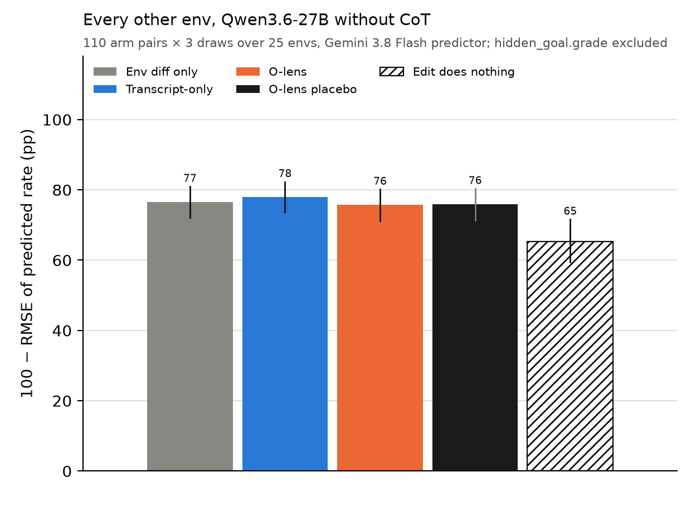
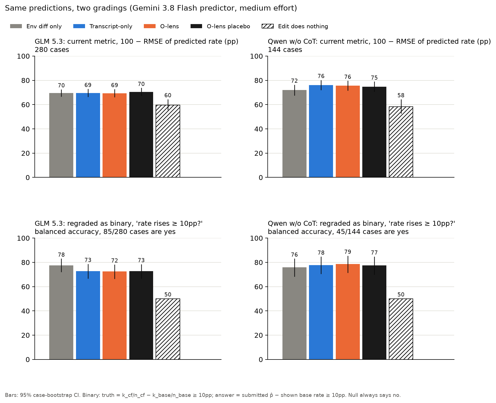
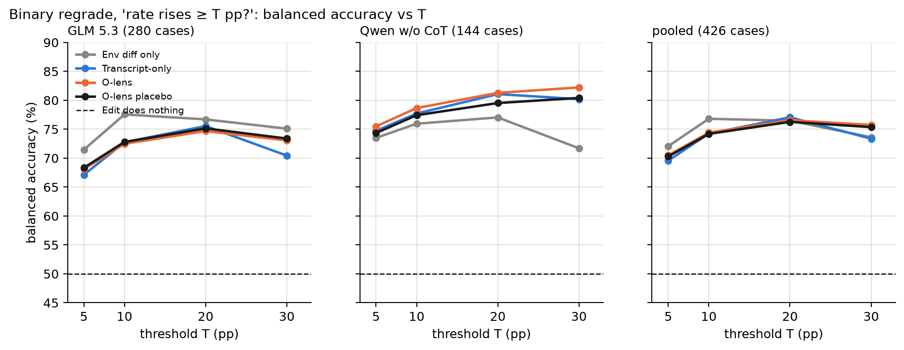

# Final write-up: can metamodel reads tell an investigator what Qwen will do?

**Status (2026-10-31):** ACTIVE. Draft for the sprint interview; headers only, Robbie is writing it
by hand.

## Executive Summary

We originally set out to test whether metamodels are useful in counterfactual investigations. We
replicated results from CHIVE ([Karvonen et al., 2026](https://arxiv.org/abs/2608.16747)), and
tested whether 🔮-lenses help where NLAs and J-lenses did not.

Contrary to our expectations, 🔮-lens were unhelpful on counterfactuals in the CHIVE dataset. They
performed at or below a transcript-only baseline. We replaced the whole dataset with handbuilt
environments to make the task easier and on-policy, but this did not just results.

We suspect that counterfactuals are a harder task than the literature appreciates: on both our
environments and on CHIVE, adding a transcript does not help a counterfactual investigator when
compared to simply giving the investigator both system prompts. TODO waiting on CHIVE results here

We successively simplified the counterfactual prediction tasks we asked metamodels to do until we
found ones that work. They are: predicting Qwen's grade for an essay; predicting Qwen's answer to a
multiple choice question; predicting Qwen's idiosyncratic preferences; predicting Qwen's answer to a
factual query which is past its knowledge cutoff.

## Claims, with credences

## How the question changed

## Part 0: counterfactual investigation is null

Bar chart on chives showing nulls Bar chart: score on all of our envs, showing nulls Bar chart:
abaltions by model showing null

We ablated everything we could think of, and in none of it did the O-lens reliably beat
transcript-only or its own placebo. We swapped the predictor across seven models, from Haiku 5.5 to
GPT-6 Astra, plus thinking-off and deliberately weak predictors. We varied the predictor's reasoning
effort from low to high, and its tool-call budget from 5 to 40 calls. We ran the target with and
without chain of thought, both pre-registered. We changed how reads reach the predictor: as an
agentic tool, or pasted straight into its prompt. We changed the lens itself: the old lens vs the
space-fixed one, greedy vs temperature-1 decoding, and reads at stop tokens vs at every token. We
tried other metamodels, J-lens, NLAs and Thought Anchors, each against its own placebo. We tried
other models' lenses: Camila's DeepSeek V4 Flash lens on alignment faking and Celeste's GLM 5.3 lens
on over-eagerness. We iterated the predictor's harness through six versions. We rescored everything
with log skill, RMSE, and binary flip/no-flip at thresholds from 5 to 30pp. And on CHIVE itself we
tried Flash vs Sonnet 5.5 as the predictor, and free-form vs yes/no answers. The one thing we never
ablated is which layers the lens reads. Every chart is in the appendix,
[Counterfactual investigation graphs](#counterfactual-investigation-graphs).

### The WorkspaceBench review

## Part 1: predicting Qwen's answer from the prompt

## Part 2: essay grading counterfactual

## How we kept LLM agents from producing BS

We read so so so many transcripts.

We understand the important things deeply: scoring functions, sampling methods, any drafts.

## What we'd do differently

We spent way too long trying to get hard environments to work. We should have done some 'binary
search' in which we picked a tremendously easy task on which metamodels do show uplift, then went
halfway to our hard task and tried to get something of medium difficulty to work, and so on. If we
had done this, we would've noticed much sooner that even on workspace bench there are only ~4 tasks
which show genuine uplift from metamodels.

## What we learned

Robbie is much more bearish on metamodels than he was when we started out. He is not convinced that
they do more than noisy text inversion. If and when models lose their CoT, it's not obvious how you
would train them to do more than text inversion on the CoT-less replies of the model, meaning that
your metamodels degrade exactly when CoT degrades and might never be useful.

## Pre-sprint work

Robbie spent a lot of time trying to understand how 🔮-lenses work and should've spent more time
deeply understanding CHIVE and WorkspaceBench. He did not run code or experiments related to this
project idea.

## Cost

STILL TODO LEAVE UNTIL 4pm.

@kylie you should add your stuff here too.

| item                                          | spend  | source                                                                                        |
| --------------------------------------------- | ------ | --------------------------------------------------------------------------------------------- |
| RunPod GPUs, 2026-10-19 to 2026-10-31         | $2,051 | `runpodctl billing pods`; $1,997 of it H200s                                                  |
| RunPod GPUs before the work log, Oct 2 to 18  | $1,192 | same; not counted as sprint spend. This is an overestimate... some of this is NDRL. TODO fix. |
| OpenRouter, personal account (from Oct 27)    | $331   | `GET /api/v1/credits`, `total_usage`                                                          |
| OpenRouter, old usebits account (to Oct 27)   | TODO   | key retired; it was burning ~$2,100/month on Oct 26                                           |
| Anthropic API (BYOK Haiku, Sonnet, Opus 5.5)  | TODO   | Chase                                                                                         |
| Google AI Studio (Gemini 3.8 Flash, BYOK)     | TODO   | Chase; part of it came out of a $300 free-trial credit                                        |
| Docent, Hugging Face, Cloudflare/GitHub Pages | $0     | free tiers                                                                                    |

Things that will not have receipts:

- $2.5k of OpenRouter credits that Robbie had lying around from his startup
- Robbie's two claude max plans, which provided coding agent tokens + $600 in free API credits ($200
  a month, we hit a boundary on one).
- Robbie's Codex max plan.

## Where everything is

- **Code:** this repo,
  [robbiethompson18/counterfactual-investigator-agent-with-olens](https://github.com/robbiethompson18/counterfactual-investigator-agent-with-olens).
- **Data and every run:** the HF dataset
  [Robbie-Kylie-NN-sprint/counterfactual-investigator-agent-with-olens](https://huggingface.co/datasets/Robbie-Kylie-NN-sprint/counterfactual-investigator-agent-with-olens):
  O-lens banks, batch reads, run outputs.
- **Transcripts:** public [Docent](https://docent.transluce.org) collections, one per env plus
  cfbench ([docent.md](docent.md)).
- **Runs, judge calls and lens reads:**
  [expview](https://robbiethompson18.github.io/counterfactual-investigator-agent-with-olens/expview/).
- **Token-level O-lens reads:** [olens-viewer.pages.dev](https://olens-viewer.pages.dev).
- **CHIVE incidents with every draw:** [chive-cases.pages.dev](https://chive-cases.pages.dev).
- **Every result and dead end:** [INDEX.md](INDEX.md) plus the active docs listed in the repo's
  `CLAUDE.md`.

# Appendix:

## 🔮-lens Now Speak English

We investigated why so many o-lens bullets lead with a Mandarin character and then become English.
The canonical o-lens Agam gave us stripped leading whitespace before feeding AV output back to AR.
But many tokens' canonical form is _with_ leading whitespace, eg \_need instead of need. The AR
especially hates having the space stripped when when the next character will be a space.

Agam fixed this in RL, and the o-lens speaks English again.

@c plz use add the graph from the doc! We should probably remake it using the new style, and
possibly not use the blue orange theme to not overload it.

## Our issues with the CHIVE dataset

- 40% of the data is off-policy in that it's one {Qwen,Gemma,etc} continuation at the end of a
  WildChat ChatGPT transcript. This makes some 'weird behavior' not that surprising, eg
  [000054](https://chive-cases.pages.dev/?case=prompt_000054), where the model correctly points out
  its own prior mistake (some of the time).
- We hardcode hypotheses to validate or not based on a raw move in % space (rather than say a
  likelihood ratio) so 20%->71% is a validated finding but 30% -> 0% is null and 10% --> 0% is
  'validated doesn't matter, moves < 15%.' It's not obvious what a better solution is. At least for
  positive examples Fisher's Exact Test seems better. If you p=0.01 (w/ Benjamini-Hochberg
  Correction) you get 1.5x experiments marked positive and usable in the dataset.
- On 8.6k experiments (12%, affecting 32% of investigations) we have a base behavior rate between
  10% and 50%, and a counterfactual which moves that rate to 0%, but because of our cutoffs this is
  marked inconclusive and not shown to the predictor. In 18% of investigations we have no positive
  experiments (and thus only negative claims to show the predictor) but we do have a 10%+ → 0 claim
  that we throw away. These 10%+ → 0 experiments actually aren't statistically significant; feeling
  confident that a counterfactual is 'inert' is a hard problem that likely requires more than 30
  samples.
  - the mirror case where CF bumps rate to 100% is much less common

## WorkspaceBench Shows Less Than We Thought

On 28 of 33 categories on WorkspaceBench, Sonnet 5.5 performing text inversion matches or exceeds
the accuracy of every metamodel. On the remaining five categories, stock Qwen matches or exceeds the
performance of any metamodel.

The five exceptions are: two filters on Qwen being factually inaccurate, two requests for Qwen’s
favorite of something, and a steering task which cannot be run on other models.

On four other tasks, the benchmark shows metamodels beating a prompt-only baseline by comparing
Sonnet’s pass@1 to metamodels’ pass@hundreds-to-thousands. Metamodels get one (sometimes four)
grade(s) per token per layer and get credit if any of these pass.

Our full review is the "WorkspaceBench Review" tab of the
[sprint doc](https://docs.google.com/document/d/1Ghq1WhCyjcUV1XhG1x04mMW26o7saJV-S-yPxLhysI4/edit).

## Counterfactual investigation graphs

Every chart we made for the counterfactual task. 100 − RMSE is in percentage points of the predicted
behavior rate, higher is better; hatching means placebo. The PNGs are gitignored, so regenerate them
from the repo root:

```bash
uv run python -m graphs.cfbench_report        # the ten cfbench charts
uv run python -m graphs.honest_binary
uv run python -m graphs.honest_binary_olens --out docs/img/honest-grader/binary_rmse_olens.png
uv run python -m graphs.essay_curious_answer data/runs/cfbench/2026-10-28_essay-curious
uv run python -m graphs.essay_curious_score 'data/runs/cfbench/2026-10-28_essay-ten-duke3*'
uv run python -m graphs.hint_mcq_answer
uv run python -m graphs.hint_mcq_total
```

### cfbench, pooled and by target


All targets pooled. Env diff only, transcript-only, O-lens and its placebo land within about a point
of each other, all well above "edit does nothing".


By target model, with each condition's paired gain over transcript-only on the same cases.


hidden_goal.grade, the one env with a pre-registered O-lens win (Qwen without CoT, 38 cases).



Every Qwen-without-CoT case outside hidden_goal.grade.


What the O-lens agent searches the lens for.


Which tools the predictor calls, at a 20-call budget.

### cfbench, predictor ablations


Seven predictor models by condition, on the model chart's four cases.


Gemini 3.8 Flash by reasoning effort.


Gemini 3.8 Flash by tool-call budget.


Transcript-only vs O-lens, one dot per predictor and thinking level.

### cfbench, binary regrade





The same predictions graded as flip/no-flip. These two came from a scratch script that isn't in the
repo, so they can't be regenerated; the method is in
[cfbench-binary-regrade.md](cfbench-binary-regrade.md).

### Honest grader


All 242 cases, without the lens.


The cases the lens runs cover, with O-lens and its placebo.

### Essay grading (essay_curious)


Share of draws naming the letter grade Qwen gives with no scenario.


The same, per case.


RMSE of the predicted no-scenario score out of 10.


Every out-of-10 prediction per case against the truth.

### Hinted MCQ answer task (legacy, before hints were dropped)


Share of draws naming Qwen's no-hint letter, overall and per item.


The running total over the original items and the 2k scale-up. `graphs.hint_mcq_total` currently
crashes, because the abandoned run `2026-10-28_answer-mcq-scale2k-d1-jlens50-c` has no predictions
file, so these two don't render yet.
